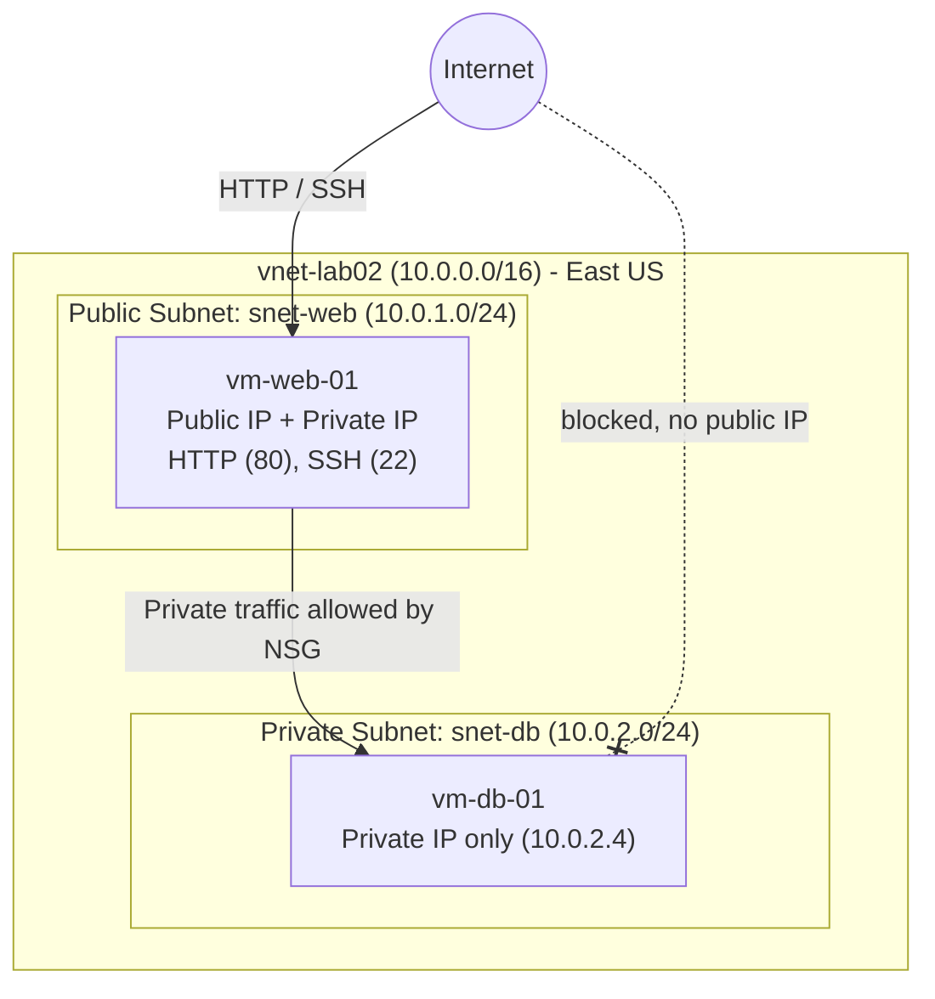

WATCH ME HERE: https://www.loom.com/share/f235f9b5f07e4b948d94ac7ed3cf59be


# Lab 02: Building a Secure 2-Tier Web Application on Azure

**Author:** Jhante Charles
**Platform:** Microsoft Azure (IaaS)
**Difficulty:** Beginner | **Estimated Time:** 60 minutes

---

## Overview

This lab builds a classic two-tier IaaS architecture in Azure. A **public-facing web server** sits in one subnet, and a **private database server** sits in another. Network Security Groups (NSGs) and the absence of a public IP on the database VM keep the back end off the internet, so only the web tier can reach it.

### What I Built

- A Virtual Network (VNet) with two subnets: one public, one private
- An Ubuntu web server with a public IP, reachable over HTTP and SSH
- An Ubuntu database server with **no public IP**, reachable only from inside the VNet
- An NSG rule that explicitly allows traffic from the web subnet to the database server
- A connectivity test proving the web tier can reach the database tier via its private IP

---

## Architecture



---

## Resources & Naming Convention

| Resource | Name | Details |
|---|---|---|
| Resource Group | `rg-lab02-[yourname]` | Container for all lab resources |
| Virtual Network | `vnet-lab02` | Address space `10.0.0.0/16` |
| Public Subnet | `snet-web` | `10.0.1.0/24` |
| Private Subnet | `snet-db` | `10.0.2.0/24` |
| Web VM | `vm-web-01` | Ubuntu Server 20.04 LTS, Standard_B1s, Standard public IP |
| Database VM | `vm-db-01` | Ubuntu Server 20.04 LTS, Standard_B1s, **no public IP** |
| SSH Key Pair | `key-lab02` | Shared by both VMs |
| NSG Rule | `Allow-Web-Subnet` | Allows `10.0.1.0/24` inbound, priority 100 |

---

## Prerequisites

- Active Azure subscription
- Completed Week 2 video modules
- A terminal with an SSH client installed

---

## Walkthrough

### Phase 1: Network Foundation

1. In the Azure Portal, search for **Virtual Networks** and click **Create**.
2. Under **Basics**, create a new resource group `rg-lab02-[yourname]`, name the VNet `vnet-lab02`, and choose region **East US**.
3. Under **IP Addresses**, set the address space to `10.0.0.0/16` and add two subnets:
   - `snet-web`: `10.0.1.0/24`
   - `snet-db`: `10.0.2.0/24`
4. Click **Review + create**, then **Create**.

### Phase 2: Web Server (Front End)

1. Search for **Virtual Machines** and click **Create**.
2. Configure the VM:
   - **Name:** `vm-web-01`
   - **Region:** East US
   - **Image:** Ubuntu Server 20.04 LTS
   - **Size:** Standard_B1s
   - **Key pair name:** `key-lab02`
   - **Public inbound ports:** HTTP (80) and SSH (22)
3. Under **Networking**, select subnet `snet-web` and create a new **Standard** public IP.
4. Click **Review + create**, then **Create**, and download the private key (`.pem`) when prompted.

### Phase 3: Database Server (Back End)

1. Create a second virtual machine:
   - **Name:** `vm-db-01`
   - **Region:** East US
   - **Image:** Ubuntu Server 20.04 LTS
   - **Size:** Standard_B1s
   - **Key pair:** existing key `key-lab02`
   - **Public inbound ports:** SSH (22)
2. **Critical step:** under **Networking**, select VNet `vnet-lab02`, change the subnet to `snet-db`, and set **Public IP** to **None**.
3. Click **Review + create**, then **Create**.

### Phase 4: Validating Connectivity (The "Jump")

Because `vm-db-01` has no public IP, it can't be reached directly from the internet. Access goes through the web server.

1. On the `vm-db-01` resource page, copy its **Private IP address** (`10.0.2.4`).
2. SSH into the web server using its public IP:

   ```bash
   ssh -i key-lab02.pem azureuser@[public-ip-of-web]
   ```

3. From inside the web server, ping the database server:

   ```bash
   ping 10.0.2.4
   ```

4. Replies confirm both servers communicate over the VNet. Press `Ctrl + C` to stop.

### Phase 5: Configuring the Firewall (NSG)

1. Open the **Networking** tab of `vm-db-01` and select its Network Security Group (e.g. `vm-db-01-nsg`).
2. Go to **Inbound security rules** and click **+ Add**.
3. Create the rule:

   | Setting | Value |
   |---|---|
   | Source | IP Addresses |
   | Source IP addresses/CIDR ranges | `10.0.1.0/24` (web subnet) |
   | Source port ranges | `*` |
   | Destination | Any |
   | Service | Custom |
   | Destination port ranges | `*` (or `3306` / `5432` if a database is installed) |
   | Action | Allow |
   | Priority | `100` |
   | Name | `Allow-Web-Subnet` |

4. Click **Add**.

> **Note:** With no public IP on `vm-db-01`, internet traffic is already blocked. This rule explicitly documents and allows the internal web-to-database path.

---

## Security Concepts Demonstrated

- **Network segmentation:** separating public and private workloads into different subnets
- **Least exposure:** the database tier has no public IP, so there is no direct internet path to it
- **NSG rules:** using source CIDR ranges and priorities to control which traffic is allowed
- **Jump-host access:** reaching a private resource by first connecting through a public-facing server
- **SSH key authentication:** using key pairs instead of passwords

---

## Screenshots

> Add your own screenshots here. Suggested captures:

<!--


-->

---

## Troubleshooting

| Issue | Cause / Fix |
|---|---|
| **Ping fails** | Confirm `vm-db-01` was deployed into `snet-db`, and that both VMs are in the same VNet (`vnet-lab02`). |
| **Can't SSH into `vm-db-01`** | Expected. It has no public IP. SSH into `vm-web-01` first. Hopping from web to DB over SSH requires the `.pem` key on the web server (or SSH agent forwarding), which is an advanced topic. |

---

## Clean Up

To avoid ongoing charges, delete the resource group, which removes every resource created in this lab:

```bash
az group delete --name rg-lab02-[yourname] --yes --no-wait
```

Or delete `rg-lab02-[yourname]` from the Azure Portal.

---

## Possible Improvements

- Install a real database (MySQL or PostgreSQL) on `vm-db-01` and restrict the NSG rule to port `3306` / `5432` instead of `*`
- Install Nginx or Apache on `vm-web-01` and serve a simple app that reads from the database
- Replace the SSH-through-web-server pattern with **Azure Bastion**
- Restrict SSH (port 22) on the web server to a specific source IP instead of the open internet
- Add a load balancer and a second web VM for high availability
- Define the infrastructure as code with Bicep or Terraform

---

## Skills Demonstrated

`Microsoft Azure` · `Virtual Networks` · `Subnetting (CIDR)` · `Network Security Groups` · `Linux VMs` · `SSH` · `Cloud Security Fundamentals` · `IaaS Architecture`

---

*Lab completed by Jhante Charles.*
